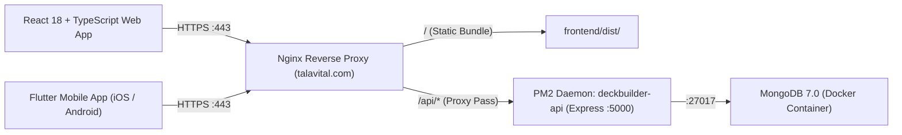

# 🃏 TCG Deck Builder & Hypergeometric Probability Calculator
**COP 4331 — Processes for Object-Oriented Software Development (Large Project)**  
🌐 **Live Production Deployment**: [https://talavital.com](https://talavital.com) | 📖 **Interactive API Docs**: [https://talavital.com/api-docs](https://talavital.com/api-docs)

---

## 📌 Project Overview

The **TCG Deck Builder & Probability Calculator** is a full-stack web and mobile platform built for competitive Trading Card Game players (Yu-Gi-Oh!, Magic: The Gathering, Pokémon). Players can build and manage tournament decks, search cards using fast server-side partial matching, simulate opening hands, and compute exact **hypergeometric draw probabilities** ($P(X \ge k)$) and **bivariate 2-card combo probabilities** in real time.

### ✨ Key Features
- **Exact Hypergeometric Math Engine**: Calculates single-card opening hand probabilities $P(X \ge k)$, exact probability mass distributions $P(X = k)$, and multivariate 2-card combo probabilities without floating-point overflow.
- **Deck & Card CRUD**: Create, edit, import/export decklists, categorize cards (`Starter`, `Extender`, `Hand Trap`, `Board Breaker`, `Engine`, `Non-Engine`), and view live draw odds alongside every card row.
- **Server-Side Partial Search API**: Case-insensitive MongoDB regex & text-indexed search across cards and decks (`GET /api/cards/search?query=...`).
- **Full Security & Account Lifecycle**: JWT Bearer authentication, `bcrypt` password hashing, strict email validation, tokenized email verification, and password recovery.
- **Cross-Platform Experience**: Minimalist React 18 + TypeScript Web App (`frontend/`) and Flutter Mobile App (`mobile/`) sharing a unified Express + MongoDB REST API (`backend/`).

---

## 🏗️ System Architecture



| Layer | Technology |
| :--- | :--- |
| **Web Frontend** | React 18, TypeScript, Vite, Minimalist Custom CSS (`Inter` & `JetBrains Mono`) |
| **Mobile App** | Flutter (Dart), `provider`, `http`, `shared_preferences` |
| **Backend API** | Node.js (20/22 LTS), Express.js, JWT (`jsonwebtoken`), `bcryptjs`, Nodemailer |
| **Database** | MongoDB 7.0 + Mongoose ODM, `mongo-express` Web GUI (Dockerized) |
| **DevOps & CI/CD** | Docker Compose, GitHub Actions CI (`ci.yml`) & CD (`deploy.yml`), DigitalOcean, Nginx, PM2 |
| **API Spec** | OpenAPI 3.0 (`swagger.json`) / SwaggerHub & Swagger UI (`/api-docs`) |

---

## 👥 Team Roster & Specialization

| Teammate | Role / Specialization | Core Contributions |
| :--- | :--- | :--- |
| **Tal** | **Project Manager & DevOps / CI-CD** | Repo scaffolding, `docker-compose.yml`, GitHub Actions CI/CD (`ci.yml`, `deploy.yml`), `scripts/deploy.sh`, DigitalOcean + Nginx + PM2 production infrastructure |
| **Michael** | **Database Engineer (MongoDB)** | Mongoose connection manager (`db.js`), `User` and `Deck`/`Card` schemas, text/partial indexes, tournament deck seeder (`seed.js`) |
| **Toricelli** | **Backend & API Engineer** | Hypergeometric math engine & unit tests (`hypergeometric.js`, `math.test.js`), JWT Auth & Email verification, Deck/Card/Search controllers, OpenAPI 3.0 Swagger spec |
| **An** | **Web Frontend Engineer (React)** | React 18 + TypeScript architecture, minimalist UI design system, AJAX JWT client, Auth modal, Deck Editor, Live Probability Calculator, and Search UI |
| **Andres** | **Mobile Engineer (Flutter)** | Cross-platform Flutter app (`mobile/`), mobile authentication flow, mobile deck browser, and mobile hypergeometric calculator screen |

---

## 🏆 COP 4331 Scoring Rubric Alignment

| Rubric Requirement | Points | Implementation & Proof |
| :--- | :---: | :--- |
| **GitHub Contribution & Activity** | **20 pts** | Equal, atomic branch-per-feature commits and PR reviews across all 5 team members. |
| **Working Project Demo (Web & Mobile)** | **20 pts** | Live React web app at `https://talavital.com` + Flutter mobile application connected to the production API. |
| **Effective Server-Side Search (Partial Match)** | **5 pts** | `GET /api/cards/search?query=Ash` performs case-insensitive partial substring matching on the backend database. |
| **Email Verification & Password Recovery** | **5 pts** | Tokenized verification (`/api/auth/verify-email`) and reset (`/api/auth/forgot-password`, `/api/auth/reset-password`) workflows. |
| **SwaggerHub API Demonstration** | **5 pts** | Full OpenAPI 3.0 spec (`backend/src/docs/swagger.json`) hosted on SwaggerHub and mounted at `/api-docs`. |
| **Presentation & Engineering Quality** | **45 pts** | System architecture, ERD, Gantt chart, unit test suite (`node --test`), Dockerization, and automated CI/CD pipeline. |

---

## 🧪 Quick Verification & `curl` API Test Commands

You can verify the live API (or local server at `http://localhost:5000`) directly from your terminal:

### 1. Health Check & Production Domain Verification
```bash
# Verify HTTPS headers on live production domain
curl -I https://talavital.com

# Check API health & uptime
curl -s https://talavital.com/api/health
```

### 2. Login with Seeded Demo Account (`demouser@ucf.edu`)
```bash
curl -s -X POST https://talavital.com/api/auth/login \
  -H "Content-Type: application/json" \
  -d '{"email":"demouser@ucf.edu","password":"password123"}'
```

### 3. Server-Side Partial Match Card Search (`query=Ash`)
```bash
curl -s "https://talavital.com/api/cards/search?query=Ash"
```

### 4. Hypergeometric Single-Card Probability Calculation
*(Example: 40-card deck, 3 copies of "Ash Blossom", 5-card opening hand, at least 1 copy drawn $\rightarrow 33.76\%$)*
```bash
curl -s -X POST https://talavital.com/api/calc/hypergeometric \
  -H "Content-Type: application/json" \
  -d '{"deckSize":40,"copiesInDeck":3,"handSize":5,"minDesired":1}'
```

### 5. Bivariate 2-Card Combo Probability Calculation
```bash
curl -s -X POST https://talavital.com/api/calc/combo \
  -H "Content-Type: application/json" \
  -d '{"deckSize":40,"handSize":5,"cardACopies":3,"cardAMin":1,"cardBCopies":3,"cardBMin":1}'
```

---

## 📚 Developer & Deployment Documentation

For full local setup instructions (`docker compose`, `.env` configuration, database seeding, unit testing, Flutter builds, and DigitalOcean deployment), see **[README_DEV.md](./README_DEV.md)**.
